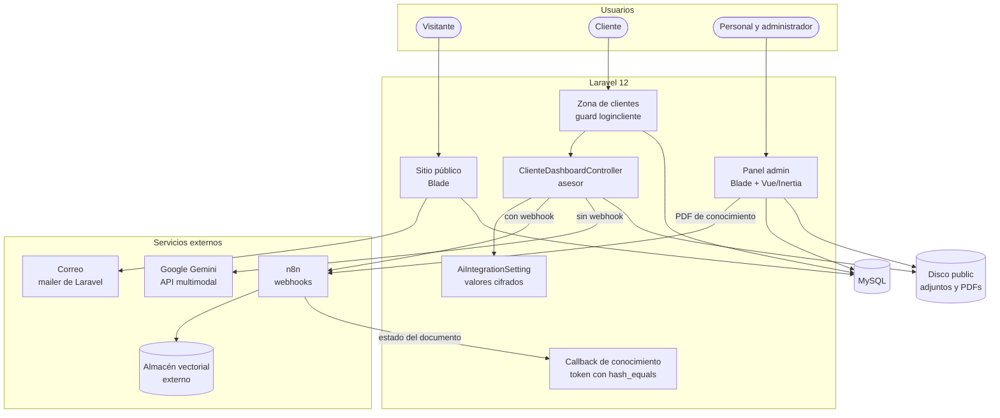
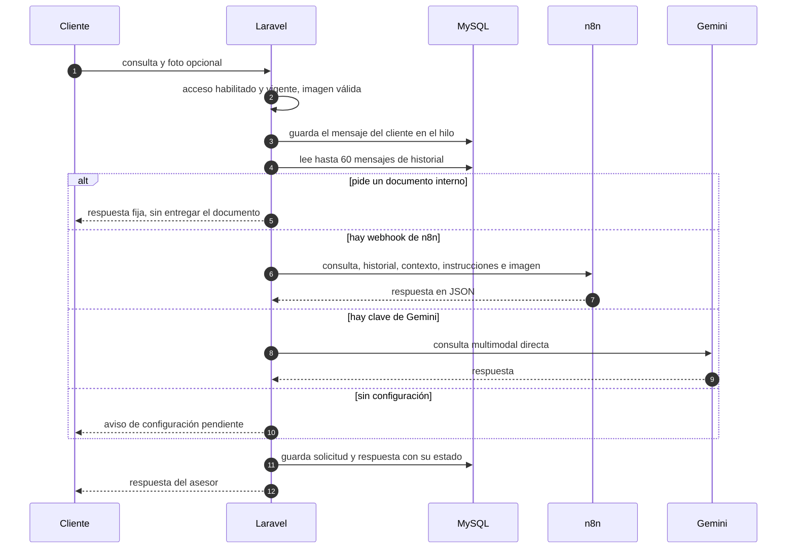
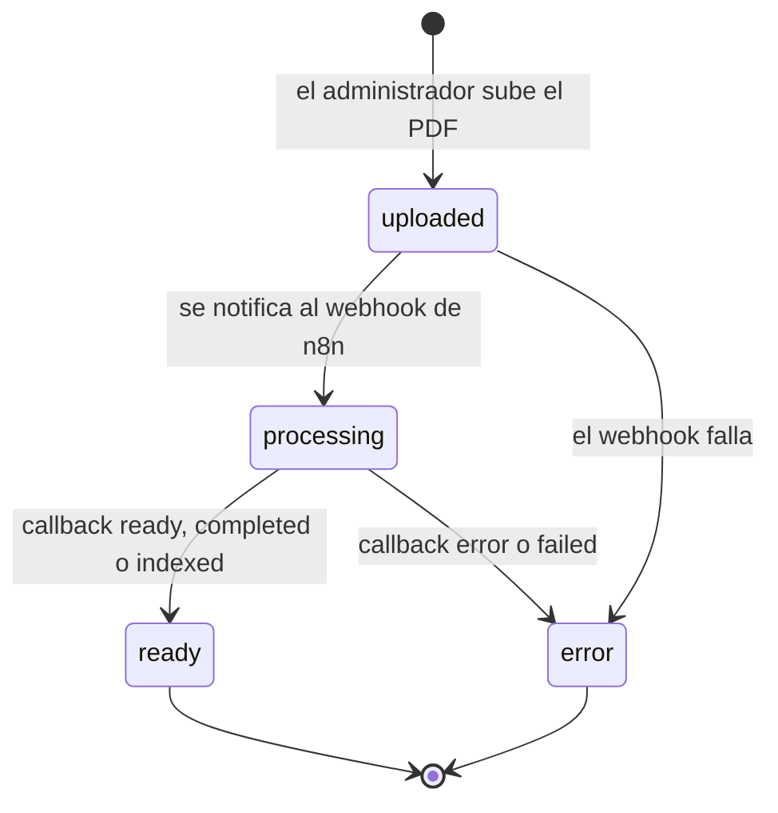
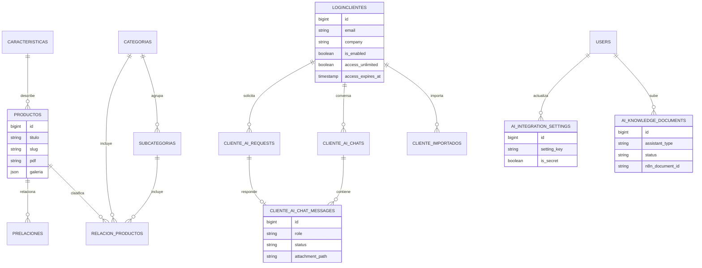

<div align="center">



<br/>

**El catálogo de AIQ, su CMS y una zona privada donde cada cliente consulta a un asesor técnico con IA.**


<br/><br/>


</div>


## 📑 Contenido

- [El problema](#-el-problema)
- [La solución](#-la-solución)
- [Funcionalidades](#-funcionalidades)
- [Arquitectura](#️-arquitectura)
- [Flujos de trabajo](#-flujos-de-trabajo)
- [Modelo de datos](#️-modelo-de-datos)
- [Criterios y decisiones](#-criterios-y-decisiones)
- [Stack](#-stack)
- [Estructura del repo](#️-estructura-del-repo)
- [Puesta en marcha](#-puesta-en-marcha)
- [Pruebas y calidad](#-pruebas-y-calidad)
- [Despliegue](#-despliegue)
- [Estado y pendientes](#-estado-y-pendientes)
- [Licencia y autoría](#-licencia-y-autoría)

## 🧩 El problema

AIQ trabaja en el rubro plástico: masterbatches, bobinas y termoformados. Sus clientes consultan por procesos, aplicaciones y requisitos técnicos, y esas respuestas dependían de que un asesor estuviera disponible. Al mismo tiempo, el sitio institucional y el catálogo necesitaban actualizarse sin tocar las vistas, y la documentación técnica interna (fichas, hojas de seguridad, certificados) no debía circular sin control.

## 💡 La solución

Un monolito Laravel que reúne el sitio público, un CMS completo y una **zona privada de clientes** con un **asesor técnico** que conserva cada conversación, acepta fotos y responde a partir de la base de conocimiento de AIQ.

| Rol | Qué hace |
|---|---|
| **Visitante** | Recorre el catálogo, busca productos, lee novedades, pide presupuesto y se suscribe al newsletter |
| **Cliente** | Se registra (queda pendiente de aprobación), entra a la zona privada y conversa con el asesor |
| **Personal interno** | Gestiona contenido, catálogo, medios, metadatos, mensajes y suscriptores |
| **Administrador** | Aprueba clientes y su vigencia, importa contactos, carga PDFs de conocimiento y configura las integraciones de IA |

## ✨ Funcionalidades

<details open>
<summary><b>Sitio público</b></summary>

- Inicio, empresa, contacto, catálogo por categorías y subcategorías, fichas de producto, paletas, bobinas y termoformados.
- Buscador, novedades y `sitemap`.
- Formularios de contacto y presupuesto con envío de correo; suscripción al newsletter.
- Enlaces de contacto por WhatsApp armados con la configuración comercial.
</details>

<details open>
<summary><b>Zona de clientes y asesor</b></summary>

- Registro con **aprobación administrativa**, habilitación y acceso ilimitado o con fecha de inicio y vencimiento.
- Guard de sesión propio (`logincliente`), separado del personal interno.
- Asesor AIQ con conversaciones persistentes, memoria de hasta 60 mensajes por hilo y adjuntos JPG, PNG o WebP de hasta 6 MB.
- Dos caminos de IA: webhook de **n8n** (con recuperación semántica externa) o consulta directa a **Gemini**.
- El cliente puede ocultar un chat de su vista; la administración lo conserva.
- Las fichas técnicas, hojas de seguridad, certificados y documentos internos no se entregan desde el asistente.
</details>

<details open>
<summary><b>Panel administrativo</b></summary>

- CMS de sliders, logos, inicio, empresa, contacto, redes, novedades, bobinas, termoformados, categorías, subcategorías, características, productos, descargas y metadatos.
- Mensajes de formularios, suscriptores y usuarios internos.
- Dashboard con actividad del asistente, tendencias de uso e historial de conversaciones.
- Importación de contactos de clientes desde XLSX, XLS, CSV y TXT.
- Base de conocimiento: carga de PDF (hasta 50 MB) y seguimiento del estado de procesamiento.
- Integraciones de IA editables desde el panel, **cifradas** en base de datos; cambiarlas exige rol `Administrador` y la contraseña actual.
</details>


## 🏗️ Arquitectura



**Monolito Laravel MVC**: Blade es la capa principal de presentación, con páginas Vue montadas por Inertia y Vite para el build. Las llamadas a la IA se hacen durante la propia petición HTTP; no hay colas propias.



La recuperación semántica no vive en Laravel: la aplicación le manda a n8n el tipo de asistente, el filtro de metadatos y el almacén esperado (`supabase_pgvector`). Embeddings, chunks y workflows no están versionados en este repositorio.

## 🔄 Flujos de trabajo

### Una consulta al asesor



### Documento de la base de conocimiento



El callback valida el token en tiempo constante, valida el payload y quita claves y tokens conocidos antes de guardar la respuesta cruda.


## 🗃️ Modelo de datos



Las claves foráneas de la zona de clientes borran en cascada; las referencias a usuarios internos usan `nullOnDelete`.

## 🧭 Criterios y decisiones

| Decisión | Por qué |
|---|---|
| Guards separados para personal y clientes | Un cliente nunca comparte sesión ni permisos con el panel; su acceso tiene vigencia propia |
| Dos caminos de IA (n8n o Gemini directo) | El RAG se orquesta afuera cuando existe; sin él, el asesor sigue funcionando con Gemini multimodal |
| Persistir chats, mensajes y solicitudes | Contexto por hilo para el cliente y trazabilidad para la administración |
| Integraciones cifradas y editables desde el panel | Se cambian sin tocar el servidor, con respaldo en variables de entorno y contraseña actual para modificarlas |
| Ocultar el chat en vez de borrarlo | El cliente limpia su vista y AIQ conserva el historial; el borrado definitivo es un comando aparte con `--dry-run` |
| Documentos internos fuera del asistente | Fichas técnicas, hojas de seguridad y certificados no se reparten por chat |
| Sin pagos | `mercadopago/dx-php` figura como dependencia, pero no se usa en el código |

## 🧱 Stack

| Capa | Tecnología | Versión |
|---|---|---|
| Backend | PHP · Laravel · Sanctum · Breeze | ^8.2 · 12.55.1 · 4.3.1 · 2.4.1 |
| Importación | Laravel Excel · PhpSpreadsheet | 4.0.2 · 5.9.0 |
| Frontend | Blade · Vue · @inertiajs/vue3 · Inertia Laravel · Tailwind CSS · Axios | 3.4.30 · 1.2.0 · 2.0.22 · 3.4.4 · 1.7.2 |
| Build | Vite | 5.3.2 |
| Datos | MySQL (SQLite en memoria para pruebas) | — |
| IA | Google Gemini (modelo por `GEMINI_MODEL`) · webhooks de n8n | — |
| Calidad | PHPUnit · Laravel Pint | 11.5.55 · 1.29.0 |

## 🗂️ Estructura del repo

```text
app/
├── Console/Commands/      clientes:purge-inactive-data
├── Http/Controllers/      sitio (PageController), admin/, Cliente/ (zona y asesor), Auth/
├── Imports/               importación de clientes desde planillas
├── Mail/                  contacto, presupuesto y newsletter
├── Models/                catálogo, contenido, clientes, chats e integraciones
└── Support/               AiqAssistantInstructions (instrucciones del asesor)
database/migrations/       esquema del catálogo, del CMS y de la zona de clientes
resources/views/           Blade del sitio, del panel y de la zona de clientes
resources/js/              páginas y componentes Vue con Inertia
routes/                    web.php, api.php (Sanctum y callback de n8n), auth.php
tests/                     Feature (auth, importación, callback) y Unit
PRODUCT.md                 usuarios, propósito y principios de diseño
```

## 🚀 Puesta en marcha

Requisitos: PHP 8.2 o superior, Composer 2, Node.js con npm y MySQL.

```bash
composer install
npm ci
cp .env.example .env && php artisan key:generate
php artisan migrate
php artisan storage:link
php artisan serve          # en otra terminal: npm run dev
```

| Grupo | Variables (sin valores en el repo) |
|---|---|
| Base de datos | `DB_CONNECTION`, `DB_HOST`, `DB_PORT`, `DB_DATABASE`, `DB_USERNAME`, `DB_PASSWORD` |
| Administrador inicial | `AIQ_ADMIN_NAME`, `AIQ_ADMIN_USERNAME`, `AIQ_ADMIN_EMAIL`, `AIQ_ADMIN_PASSWORD` (el seeder solo crea la cuenta si están) |
| Correo | `MAIL_MAILER`, `MAIL_HOST`, `MAIL_PORT`, `MAIL_USERNAME`, `MAIL_PASSWORD`, `MAIL_FROM_ADDRESS` |
| IA | `GEMINI_API_KEY`, `GEMINI_MODEL`; los webhooks de n8n se cargan desde el panel o desde `config/services.php` |

Para producción: `npm run build`.

## 🧪 Pruebas y calidad

```bash
php artisan test --compact
./vendor/bin/pint --test
```

- Pruebas de autenticación, registro, contraseñas, perfil, correo, **callback de conocimiento** (tokens inválidos y que no se guarden secretos) e **importación** XLSX/XLS/CSV; 28 métodos de prueba en `tests/` por conteo estático.
- La última verificación documentada (PHP 8.5.5, SQLite en memoria) dio 30 pruebas y 89 aserciones en verde y un build de producción correcto; no se volvió a correr para este README.
- Pint todavía marca diferencias en archivos heredados. No hay análisis estático, cobertura, E2E ni CI.

## 🚢 Despliegue

No documentado en el repositorio: no hay Dockerfile, Compose ni workflows. La aplicación necesita PHP, MySQL, un servidor web con HTTPS y escritura en `storage` y `bootstrap/cache`.

- Los adjuntos y PDFs van al disco `public`: hay que revisar su exposición en cada servidor.
- `clientes:purge-inactive-data` (con `--dry-run`) elimina cuentas deshabilitadas, chats vencidos y sus adjuntos; no está programado en el scheduler, se corre a mano o con un cron externo.

## 📌 Estado y pendientes

- **Último commit:** 12 de agosto de 2026 (`fix ia`), rama `main`, 3 commits. Hay cambios sin commitear en autenticación, controladores del panel y pruebas.
- Funcional y en evolución. Si está en producción **no está verificado** desde el repositorio.
- Deuda conocida: el middleware `verified` del panel no tiene efecto porque `User` no implementa `MustVerifyEmail`; solo las integraciones exigen el rol `Administrador`; formato con Pint en archivos heredados; la dependencia de Mercado Pago sin uso.

## 📄 Licencia y autoría

Software propietario de AIQ. Todos los derechos reservados: no se distribuye ni se publica sin autorización. Datos de clientes, conversaciones, adjuntos, PDFs internos y claves de integración nunca forman parte del repositorio.

Desarrollado por **Ing. Santiago Abasto**, único autor del historial de git.

<div align="center">
<br/>

<sub>AIQ · sitio, catálogo y asesor técnico con IA para la industria plástica</sub>
</div>
